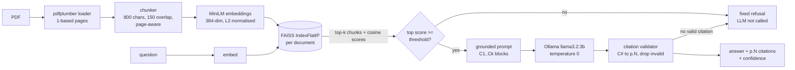

# RAG Document QA

Ask questions about a PDF and get answers that cite their pages, carry a real confidence score,
and refuse when the document does not say. Everything runs on your machine: pdfplumber,
sentence-transformers, FAISS and Ollama. No network calls at answer time.



## Results

Measured by `eval/run_eval.py` on the 40-question golden set (30 answerable, including
multi-page, table and short/vague phrasings; 10 unanswerable). The table below is written by
`python -m eval.run_eval --sweep --update-readme` from a real run; it is never edited by hand.

<!-- eval:start -->
Not measured yet. Run `.\run.ps1 eval` (or `make eval`) with Ollama running, then
`python -m eval.run_eval --sweep --apply --update-readme` to fill this in.
<!-- eval:end -->

## Quickstart (local)

```bash
make install                      # Windows: .\run.ps1 install   (Python 3.11+)
ollama serve                      # in another terminal
ollama pull llama3.2:3b
make run                          # Windows: .\run.ps1 run
```

Open http://localhost:8000 for the UI, or http://localhost:8000/docs for the API. The first run
downloads `all-MiniLM-L6-v2` (~90 MB); after that nothing leaves the machine.

| Make | Windows | What it runs |
| --- | --- | --- |
| `make install` | `.\run.ps1 install` | venv + dependencies |
| `make run` | `.\run.ps1 run` | API + UI on `127.0.0.1:8000` |
| `make test` | `.\run.ps1 test` | unit tests (offline, `HashEmbedder` + `FakeLLM`), 85% coverage gate |
| `make test-int` | `.\run.ps1 test-int` | real MiniLM + Ollama tests; each skips with a reason when unavailable |
| `make eval` | `.\run.ps1 eval` | golden-set evaluation with the threshold sweep |
| `make lint` | `.\run.ps1 lint` | `ruff check` + `ruff format --check` |
| `make docker-up` | `.\run.ps1 docker-up` | `docker compose up --build` |

Command-line tools work without the server:

```bash
python -m app.ingest tests/fixtures/handbook.pdf
# handbook.pdf · 42 pages · 165 chunks indexed · 8d9ae4a8c463
python -m app.ask 8d9ae4a8c463 "What's the refund window?"
```

## Quickstart (Docker)

```bash
docker compose up --build
```

This starts Ollama, pulls `LLM_MODEL` (default `llama3.2:3b`) into a volume on first start, then
starts the app on http://localhost:8000. Indexes and the embedding weights live in volumes, so
restarts are fast. `curl localhost:8000/health` shows `"ollama": "up"` once the model is pulled.

## API

```bash
# health: is Ollama up and the model pulled?
curl -s localhost:8000/health
# {"status":"ok","ollama":"up","model":"llama3.2:3b","model_available":true,...}

# upload a PDF: 201 when new, 200 when the same file is already indexed
curl -s -F "file=@tests/fixtures/handbook.pdf" localhost:8000/documents
# {"doc_id":"8d9ae4a8c463...","filename":"handbook.pdf","pages":42,"empty_pages":[33],"chunks":165,...}

# list, inspect (full id or the 12-character prefix), delete
curl -s localhost:8000/documents
curl -s localhost:8000/documents/8d9ae4a8c463
curl -s -X DELETE localhost:8000/documents/8d9ae4a8c463      # 204, then 404 on GET

# ask
curl -s localhost:8000/ask -H "Content-Type: application/json" \
  -d '{"doc_id": "8d9ae4a8c463", "question": "What is the refund window?"}'
# {"answer":"... [p.12].","citations":[{"chunk_id":"...","pages":[12],"score":...,"snippet":"..."}],
#  "confidence":...,"sources":1,"refused":false,"grounded":true,"latency_ms":...,
#  "load_ms":...,"answer_ms":...,"model":"llama3.2:3b"}
```

In PowerShell, use `curl.exe` (not the `curl` alias), and for `/ask`:
`Invoke-RestMethod localhost:8000/ask -Method Post -ContentType application/json -Body '{"doc_id":"8d9ae4a8c463","question":"What is the refund window?"}'`.

| Status | When |
| --- | --- |
| 400 | upload is not a PDF (checked by magic bytes) or cannot be parsed |
| 404 | unknown `doc_id` |
| 413 | upload larger than `MAX_UPLOAD_MB` |
| 422 | empty or >500-char question, `top_k` outside 1-10 |
| 503 | Ollama not running or model not pulled (message says which command fixes it) |

`confidence` is the real cosine similarity of the best chunk the answer cites (for a refusal,
the best retrieved chunk). It is not rescaled or calibrated, and the UI shows the same number.

## Configuration

Every setting can be overridden with an environment variable (or a `.env` file).

| Variable | Default | Meaning |
| --- | --- | --- |
| `CHUNK_SIZE` | `800` | max characters per chunk |
| `CHUNK_OVERLAP` | `150` | characters shared by consecutive chunks |
| `EMBED_MODEL` | `sentence-transformers/all-MiniLM-L6-v2` | embedding model; `hash` selects the offline test embedder |
| `DATA_DIR` | `data/indexes` | where indexes are stored |
| `TOP_K` | `5` | chunks retrieved per question |
| `CONFIDENCE_THRESHOLD` | `0.35` | below this top-1 cosine score the system refuses without calling the LLM |
| `OLLAMA_URL` | `http://localhost:11434` | Ollama server |
| `LLM_MODEL` | `llama3.2:3b` | Ollama model, e.g. `llama3.1:8b` |
| `LLM_TIMEOUT_S` | `60` | per-request timeout (2 retries) |
| `OLLAMA_KEEP_ALIVE` | `30m` | how long Ollama keeps the model loaded after a request |
| `MAX_CONTEXT_CHARS` | `6000` | context budget; lowest-scoring chunks are dropped to fit |
| `MAX_UPLOAD_MB` | `20` | upload size limit for `POST /documents` |
| `LOG_LEVEL` | `INFO` | JSON request logs on stdout (ids, sizes, timings; never document text) |

## How ingestion works

- **Loader** (`app/ingest/loader.py`): pdfplumber, 1-based page numbers, whitespace normalised,
  paragraphs rebuilt from line spacing, line-break hyphens removed. Pages with fewer than 20
  characters are flagged `is_empty` (no OCR). Non-PDF, corrupt and password-protected files
  raise `InvalidPDFError`.
- **Chunker** (`app/ingest/chunker.py`): the pages are read as one continuous text so a sentence
  that runs over a page break stays together. Each chunk ends at the strongest boundary that
  fits (paragraph, then sentence, then word) and never mid-word; the next chunk starts inside the
  last `CHUNK_OVERLAP` characters. Each chunk lists every page it touches, e.g. `[20, 21]`.
- **Store** (`app/index/store.py`): one folder per document named by the SHA-256 of the file,
  holding `index.faiss` (`IndexFlatIP` over L2-normalised vectors, so scores are cosine
  similarity), `chunks.jsonl` and `manifest.json`. Writes go to a temp folder and are renamed
  into place.

## How answering works

`Answer.load_ms` is one-off loading paid by that call (embedding model, FAISS index, and the
Ollama model if it was not resident); `Answer.answer_ms` is retrieval plus generation. Each CLI
run is a fresh process, so it pays the embedding-model load every time; the API loads it once at
startup. When the embedding model is already in the Hugging Face cache, `HF_HUB_OFFLINE=1`
is set automatically so loading it makes no network calls (an explicit `HF_HUB_OFFLINE` wins).

- **Retriever** (`app/qa/retriever.py`): top-k FAISS search, drops near-duplicate chunks (one
  contained in the other, or word Jaccard >= 0.8) keeping the higher score, then trims to
  `MAX_CONTEXT_CHARS`.
- **Confidence gate**: if the best cosine score is below `CONFIDENCE_THRESHOLD`, the answer is
  the fixed refusal and the LLM is never called.
- **Prompt** (`app/qa/prompt.py`): context blocks tagged `[C1]..[Ck]` with page headers inside
  `<context>` tags; rules say to answer only from the context, cite every sentence, refuse with
  an exact phrase, and treat the context as text rather than instructions.
- **LLM** (`app/qa/llm.py`): Ollama `/api/chat`, temperature 0 and a fixed seed, timeout and 2
  retries. A stopped server or a missing model raises `LLMUnavailableError` with the command to
  fix it; the CLI prints it as one line and exits with code 3.
- **Citation validation** (`app/qa/answerer.py`): `[C#]` tags become `[p.12]` or `[p.20-21]`,
  tags outside the retrieved set are dropped, and an answer with no valid citation (or the
  refusal phrase) is returned as a refusal. Confidence is the highest score among the chunks
  the answer actually cites.

## Evaluation

`python -m eval.run_eval --sweep` ingests the fixture, asks all 40 golden questions once with
the confidence gate off, then computes, for every threshold from 0.20 to 0.60 in 0.05 steps:

- **hit@5**: a gold page is in the top 5 retrieved chunks (answerable questions)
- **answer accuracy**: not refused and every gold keyword present (`a|b` accepts either)
- **refusal accuracy**: unanswerable questions that were refused
- **false-refusal rate**: answerable questions that were refused
- **citation precision**: answered questions whose cited pages are all gold pages
- **p50/p95 latency**, and the top retrieval score for answerable vs unanswerable questions

The gate only looks at the top score, so each threshold's outcome is computed exactly from the
one run. The best threshold maximises (answer accuracy + refusal accuracy) / 2, ties going to the
lower false-refusal rate. `--apply` writes it into `app/config.py`; `--update-readme` refreshes
the Results table. Full per-question output goes to `eval/results.md` and `eval/results.json`.

## Design decisions

- **Cosine as confidence.** Vectors are L2-normalised and FAISS uses inner product, so a score
  is cosine similarity and directly comparable across questions. The threshold is tuned on data
  by the sweep rather than guessed.
- **Gate before generation.** Below the threshold the LLM is never called, which is fast and
  cannot hallucinate.
- **Citations validated after generation.** The model cites `[C#]` blocks; the code maps them to
  pages, drops invented ones, merges overlapping pages, and refuses answers with no valid citation.
- **Prompt injection.** Document text is wrapped in `<context>` and the rules treat it as text;
  even if a model obeys injected text, an uncited answer is refused.
- **Page-aware chunking.** Pages are chunked as one stream so sentences crossing a page break
  stay whole, and each chunk records every page it touches.
- **Fully local.** Embeddings, FAISS and the LLM run on the machine. `HF_HUB_OFFLINE=1` is set
  automatically once the embedding model is cached.

## Limitations

- No OCR: scanned pages are flagged empty and not indexed.
- One document per question; no cross-document search.
- Short or vague questions score lower cosine similarity and can be refused; the golden set
  includes such phrasings so the false-refusal rate is measured, not hidden.
- Tables are extracted as text rows, so complex tables lose their structure.
- Answer accuracy uses keyword matching, so a correct answer that words a number differently
  (for example "a month" for "30 days") is counted as wrong.

## Test fixture

`scripts/make_fixture_pdf.py` deterministically generates a 42-page "Acme Store Employee
Handbook" with planted facts on known pages, listed in `tests/fixtures/planted_facts.json`:
the refund policy on p.12, a warranty sentence split across pp.20-21, a shift-allowance table
on p.27, a near-blank p.33, plus extra facts for the Phase 3 golden set.
